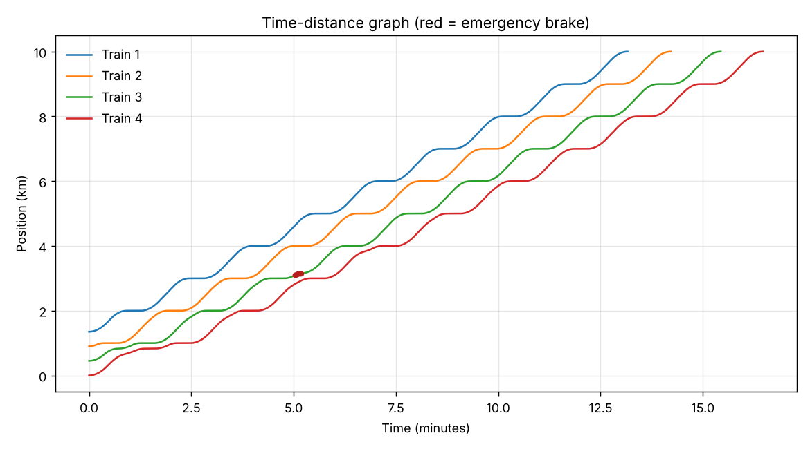

# Train Control Simulator (C++)

[](https://github.com/Snehachowdary56/train-control-sim/actions/workflows/ci.yml)

A multithreaded simulation of communication-based train control (CBTC) on a 10 km line. Trains report their
position over TCP sockets to a zone controller, which sends back a **movement authority**: how far each train
may go without getting too close to the train ahead. Each train brakes in time to stay inside it, stops at
stations, and applies the emergency brake if the radio link drops.

Runs on **Windows** (MSVC, Winsock2) and **Linux** (GCC, POSIX sockets). A **Perl** tool checks the run logs,
and a **Python** data-mining step flags unusual train runs with an Isolation Forest.

> A simplified teaching model of how CBTC works, not a certified signalling system.



## Results (4 trains, train 3 loses radio for 4 s at t = 300 s)

| Check | Result |
|---|---|
| Position reports handled by the zone controller | about 17,800 |
| Movement authority violations | 0 |
| Closest approach to the train ahead | 50.5 m (safety margin 50 m) |
| Emergency brakes | 1, on train 3 only, during the radio loss; it recovered and finished |
| Times trains were held back by the train ahead | 16 (train 3: 1, train 4: 15) |
| Isolation Forest | flagged 4 of 39 train-segments, including the emergency-brake segment |
| Stress test | 12 trains, 300 m apart: 0 violations |
| ThreadSanitizer | no data races |

Exact counts vary slightly between runs because threads are scheduled differently; the safety checks hold
every time.

## How it works

1. **Train thread** (onboard): every 0.1 s it updates speed and position. Every 0.2 s it sends
   `POS <train> <seq> <position> <speed>` and reads back `MA <train> <seq> <limit>`.
2. **Zone controller** (wayside): one thread per train; all positions are in one map behind a mutex.
   MA = rear of the train ahead − 50 m, or the end of the line for the lead train.
3. **Braking curve:** brake when `stopping distance = v·t_reaction + v²/2b` reaches the nearest target
   (MA or next station).
4. **Radio loss:** no fresh MA for 2 s → emergency brake until stopped and the link is back.
5. A step barrier (mutex + condition variable) keeps all train threads on the same simulated time step.

More detail: [design](docs/DESIGN.md) · [requirements with traceability](docs/REQUIREMENTS.md) ·
[design review](docs/DESIGN_REVIEW.md) · [defect reports](docs/DEFECTS.md)

## Run it

### Windows (Command Prompt, needs Visual Studio Build Tools and CMake)

```
cmake -S . -B build
cmake --build build --config Release
ctest --test-dir build -C Release
build\Release\cbtc_sim.exe --trains 4 --radio-loss 3:300:304 --log run.csv
perl tools\log_report.pl run.csv
```

### Linux

```bash
cmake -S . -B build -DCMAKE_BUILD_TYPE=Release && cmake --build build -j
ctest --test-dir build
./build/cbtc_sim --trains 4 --radio-loss 3:300:304 --log run.csv
perl tools/log_report.pl run.csv --junit report.xml
pip install -r requirements.txt && python -m analysis.anomalies run.csv
```

## Tests

| Layer | Tests |
|---|---|
| Control logic (C++) | braking distance, MA, never passing the MA, station stops, emergency brake and recovery, speed limit |
| Protocol (C++) | round trip, malformed and invalid messages rejected |
| Integration (C++, real sockets and threads) | 4 trains, radio loss, 12-train stress test |
| Perl | 7 tests for the log checker (`prove tools/t`) |
| Python | 3 tests for the anomaly detection |
| CI | Linux build + tests + scenario + reports, ThreadSanitizer, Windows MSVC build + tests |

## Layout

```
src/        control.hpp (logic), protocol.hpp, net.* (Winsock/POSIX), zone_controller.*, simulation.*, main.cpp
tests/      C++ unit, integration and stress tests
tools/      log_report.pl (Perl) and its tests
analysis/   anomalies.py (pandas, scikit-learn, matplotlib) and tests
docs/       design, requirements, design review, defect reports, train graph
```
