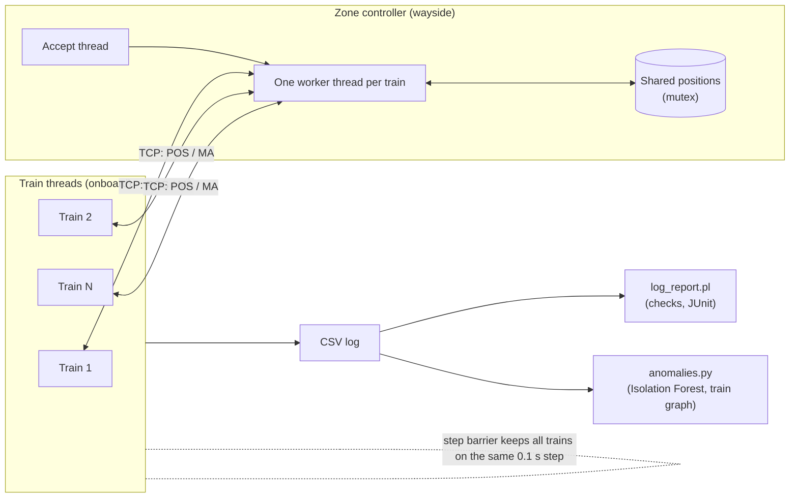

# Design

## Architecture

This follows the idea of communication-based train control (CBTC): trains report where they are, the
wayside controller decides how far each train may go, and the onboard logic enforces it with a braking curve.
It is a simplified teaching model, not a certified signalling system.

## Components

| Component | File | Responsibility |
|---|---|---|
| Control logic | `src/control.hpp` | Braking distance, movement authority, one control step per train. Pure functions, no I/O, so it is unit tested directly. |
| Protocol | `src/protocol.hpp` | Encode and parse the two text messages. Rejects malformed input. |
| Network | `src/net.hpp`, `src/net.cpp` | TCP sockets with one interface for Windows (Winsock2) and POSIX. Handles partial sends and line framing over a byte stream. |
| Zone controller | `src/zone_controller.*` | Accept thread plus one worker thread per train; shared state behind one mutex. |
| Simulation | `src/simulation.*` | Starts the controller, one thread per train, a step barrier, collects logs and summaries. |
| CLI | `src/main.cpp` | Runs a scenario. On Windows a console control handler (`SetConsoleCtrlHandler`) stops trains cleanly on Ctrl+C; on Linux a SIGINT handler does the same. |

## Threading model

- **Zone controller:** 1 accept thread + 1 worker thread per connected train. Workers only hold the mutex
  while reading/updating the position map and computing the MA; sending the reply happens outside the lock.
- **Trains:** 1 thread each. After every 0.1 s step a train waits at a `StepBarrier` (mutex + condition
  variable) so all trains move through simulated time together. A finished train calls `arrive_and_drop`
  so the others stop waiting for it.
- **Shutdown:** `stop()` wakes the blocked `accept()` with a throwaway loopback connection (works the same on
  Windows and Linux), shuts down every client socket to wake blocked `recv()` calls, then joins every thread.
- Verified with ThreadSanitizer in CI.

## Safety argument (simplified)

1. A train ahead only moves forward, so its last reported position is never ahead of where it really is.
   An MA computed from it is therefore conservative.
2. The onboard step looks one step ahead (`stopping distance + v·dt + 0.5 m`), so the discrete simulation
   cannot overshoot the target.
3. Losing the radio for more than 2 s triggers the emergency brake, so a train never runs on an old MA.
